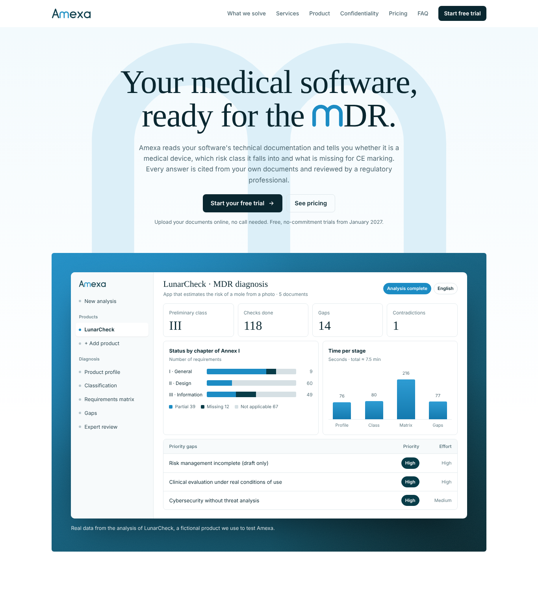
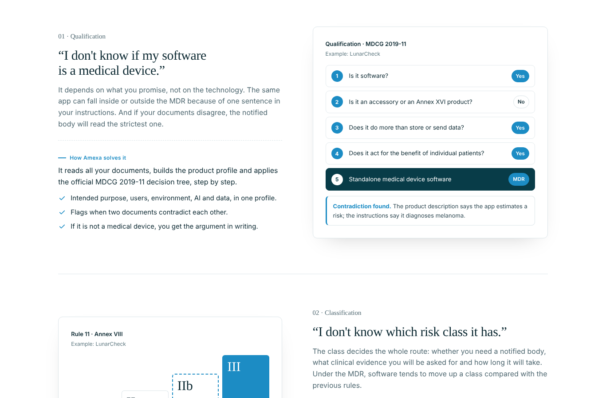

<h3 align="center">Diagnóstico regulatorio MDR con IA para startups de software sanitario</h3>

  <a href="https://dsegadovizcaino-crypto.github.io/amexa/"><strong>Ver la web</strong></a> ·
  <a href="https://dsegadovizcaino-crypto.github.io/amexa/start.html?service=diagnosis">Probar el diagnóstico gratis</a> ·
  <a href="https://dsegadovizcaino-crypto.github.io/amexa/#pricing">Precios</a>

---

## Qué es Amexa

Amexa lee la documentación técnica de un software sanitario y prepara un borrador de diagnóstico según el Reglamento europeo de productos sanitarios (MDR, Reglamento (UE) 2017/745):

1. **Ficha del producto.** Finalidad, usuarios, entorno, uso de IA y datos que maneja. Avisa si dos documentos se contradicen.
2. **Clase de riesgo.** Si es producto sanitario (guía MDCG 2019-11) y su clase según la Regla 11 del Anexo VIII, razonada paso a paso.
3. **Matriz de requisitos.** Los 23 requisitos generales de seguridad y funcionamiento del Anexo I, divididos en 118 comprobaciones, cada una con su estado y una cita literal de los documentos.
4. **Plan de carencias.** Lo que falta, ordenado por prioridad, con el entregable que lo cierra.

El resultado se descarga en Excel y Word, en español o en inglés. Antes de llegar al cliente, cada resultado lo revisa una profesional de asuntos regulatorios con más de 7 años de experiencia en el sector de los productos sanitarios.

## Servicios

- **Diagnóstico MDR gratis y sin compromiso**, para que el cliente vea la calidad antes de pagar.
- **Class I SaMD package**: expediente técnico MDR para software de clase I.
- **Class IIa SaMD package**: expediente técnico MDR para software de clase IIa.
- **Planes mensuales o anuales**: Essential (490 €/mes), Growth (990 €/mes) y Audit Ready (1.900 €/mes), con dos meses gratis en el plan anual.

El cliente puede elegir un plan, pagar con tarjeta (Stripe) y subir sus documentos desde la web (`start.html`) sin necesidad de llamada.

## El problema que resuelve

Para vender un software sanitario en Europa hay que demostrar que cumple el MDR. Para una startup eso significa leer cientos de páginas de normativa, acertar con la clase de riesgo y descubrir a tiempo lo que falta en el expediente. Llegar incompleto al organismo notificado puede hacer que rechacen la solicitud y que la espera vuelva a empezar.

## Primera prueba real (noviembre de 2026)

Probamos Amexa con **LunarCheck**, un producto ficticio creado para pruebas: una app que estima el riesgo de un lunar a partir de una foto.

| Resultado | Valor |
| --- | --- |
| Comprobaciones de los 23 requisitos del Anexo I | 118 |
| Comprobaciones superadas frente a las respuestas esperadas | 24 de 24 |
| Clase propuesta | III (con IIb como alternativa razonada) |
| Contradicción entre documentos detectada | Sí |
| Carencias detectadas y priorizadas | 14 |
| Duración del análisis (5 documentos) | ≈ 8 minutos |

Son cifras de un caso de prueba, todavía no de clientes.

## Cómo funciona por dentro

- **Lectura de documentos** PDF y Word, divididos en fragmentos con su página y apartado.
- **Búsqueda híbrida** (vectores y texto) calculada en local: el texto no se envía a servicios de terceros para indexarlo.
- **Razonamiento con Claude (Anthropic)** sobre los textos oficiales: MDR, Anexo I, Anexo VIII y guías MDCG 2019-11, 2019-16 y 2020-1.
- **Verificación de citas** palabra por palabra contra el documento original. Una cita que no aparece tal cual se descarta.
- **Exportación** a Excel y Word, y un módulo de revisión para que el experto acepte, corrija o rechace cada fila.

Tecnologías: Python, Claude API, Pydantic, fastembed, Flask, openpyxl y python-docx.

## Este repositorio

Contiene la web pública de Amexa, en inglés: la página principal (`index.html`), la página para subir documentos (`start.html`), las condiciones y la privacidad (`legal.html`), la configuración de pagos y subida (`config.js`) y las imágenes (`img/`). El código del analizador es privado.

## Estado

Piloto. Estamos reservando plazas para los primeros diagnósticos, gratis y sin compromiso, a partir de enero de 2027.

## Equipo

- **Daniel Segado Vizcaíno**, fundador: producto, negocio y relación con clientes.
- **Bruno Marconi**, desarrollo de la primera versión del software.

## Contacto

[amexa.mdr@gmail.com](mailto:amexa.mdr@gmail.com)
